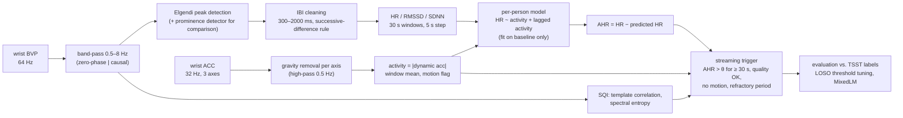
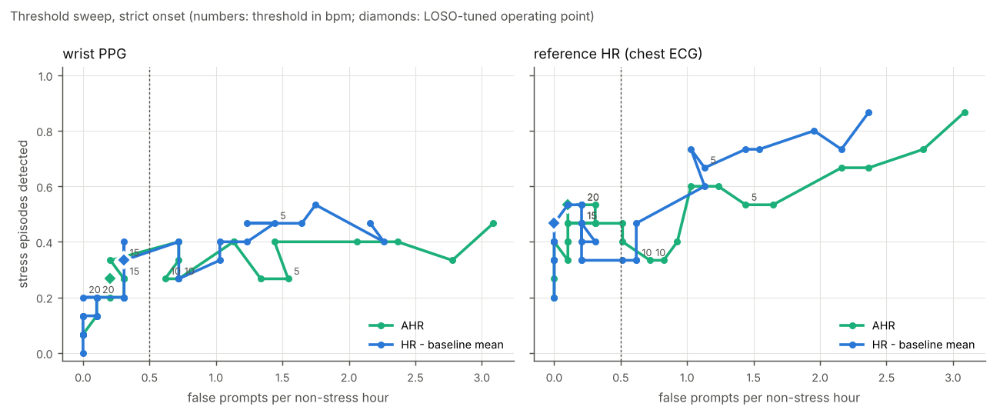
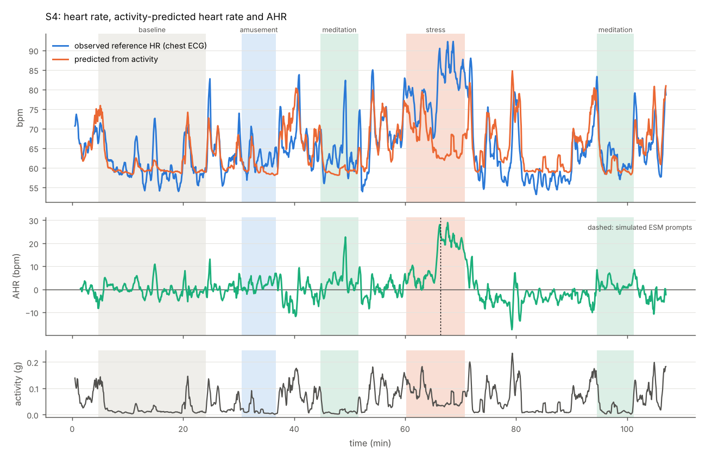
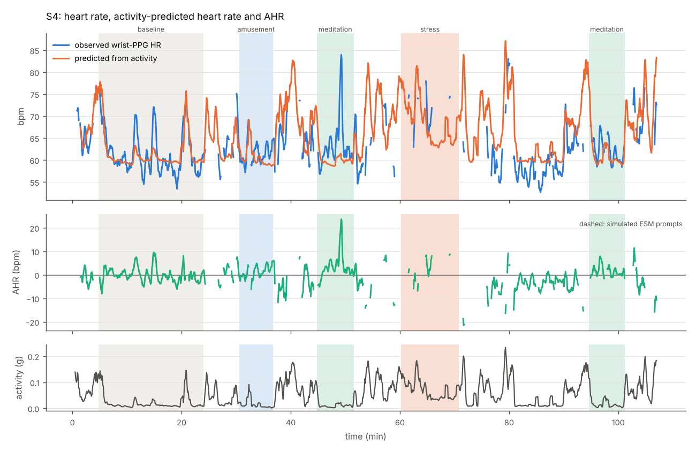

# ahr-stress-trigger

**Additional heart rate (AHR) estimation and a simulated real-time ESM trigger on wrist PPG + accelerometry (public WESAD dataset).**

Wearable stress detection often starts from heart rate, but heart rate is driven mostly by
physical activity: in everyday life, walking up a staircase raises HR far more than a stressful
e-mail does. A trigger that fires on raw HR therefore mostly detects movement. The
*additional heart rate* idea (Myrtek, 2004) is to predict, per person, the heart rate that the
current physical activity explains, and to treat only the remainder, **AHR = HR − HR̂(activity)**,
as a candidate psychological signal. AHR can then trigger an experience-sampling (ESM) prompt
or a just-in-time intervention in daily life.

This repository implements that chain end to end on public data, with every step that a
real-time system would run implemented causally (past data only):



## Quick start

```bash
pip install -e ".[test]"          # Python >= 3.11; numpy, scipy, pandas, statsmodels, matplotlib
pytest                            # 41 unit tests on synthetic signals, no download needed

python scripts/run_all.py --synthetic        # whole pipeline on synthetic subjects -> results/synthetic/
python scripts/download_wesad.py             # official WESAD download (~2.1 GB) + compact local cache in data/
python scripts/run_all.py                    # whole pipeline on WESAD -> results/  (~10 min)
```

`data/` is git-ignored. **No WESAD file or per-sample derived data is committed**; `results/`
holds only aggregated tables and figures.

## Repository layout

| Path | Content |
|---|---|
| `src/ahr/io_wesad.py` | WESAD loader: wrist BVP/ACC/EDA/TEMP as tidy frames with time index and label (time-aligned to the 700 Hz label stream); compact cache |
| `src/ahr/ppg.py` | detrending, Butterworth band-pass (zero-phase and causal + streaming class), analytic and measured group delay, Elgendi and prominence peak detectors, IBI cleaning, interpolation, windowed HR / RMSSD / SDNN |
| `src/ahr/sqi.py` | beat-template correlation and spectral-entropy SQIs per window |
| `src/ahr/motion.py` | per-axis gravity removal, activity magnitude, motion flag |
| `src/ahr/pipeline.py` | raw signals -> per-window feature table (offline or causal) |
| `src/ahr/ahr.py` | per-person activity -> HR model, AHR |
| `src/ahr/trigger.py` | streaming ESM trigger simulator |
| `src/ahr/evaluate.py` | trigger metrics, threshold sweep, LOSO tuning, MixedLM |
| `src/ahr/ecg.py` | chest-ECG R-peak detector, used **only** as a heart-rate reference |
| `src/ahr/synthetic.py` | synthetic PPG + accelerometer with known ground truth |
| `scripts/` | `download_wesad.py`, `run_all.py` |
| `results/` | aggregated results of the WESAD run (`results/synthetic/`: synthetic run) |

## Methods in brief

**Data.** WESAD (Schmidt et al., 2018): 15 participants, lab protocol with baseline (~20 min),
TSST stress (~10 min), amusement and guided meditation, ~1.5–1.8 h per session. Only the wrist
device (Empatica E4) is used by the pipeline: BVP 64 Hz and ACC 32 Hz (converted from 1/64 g to g).
Labels (700 Hz) are aligned by time. The chest ECG is used only to validate wrist HR and as an
"ideal HR sensor" reference condition for the trigger (see below).

**PPG.** 2nd-order Butterworth band-pass 0.5–8 Hz, forward-backward (offline) or forward only
(causal). Systolic peaks with the two-moving-average detector of Elgendi et al. (2013); in causal
mode the averages are trailing and a beat only becomes available when its block ends. A
`scipy.signal.find_peaks` prominence detector is computed for comparison. IBIs outside
300–2000 ms or deviating > 25 % from the median of the last 5 accepted IBIs are rejected (past-only,
so usable in streaming). HR, RMSSD and SDNN are computed in trailing 30 s windows every 5 s; a
window needs valid IBIs covering ≥ 50 % of it.
*E4 polarity:* detection runs on the sign-inverted E4 BVP, which gave more physiologically
plausible IBIs in all 15 subjects (mean share of accepted IBIs 0.76 vs 0.66).

**Signal quality.** A window is usable when beat-template correlation ≥ 0.8 (offline) / ≥ 0.7
(causal; the causal filter's non-linear phase distorts the pulse shape) and spectral entropy
≤ 0.75. Thresholds were chosen by comparing wrist HR with chest-ECG HR (see *Parameter choices*).

**Motion.** Gravity is removed from each accelerometer axis separately (0.5 Hz high-pass)
*before* taking the vector magnitude; the window mean of that magnitude is the activity measure,
and windows above 0.1 g are flagged as motion. (Taking `|acc| − 1 g` first under-estimates motion
orthogonal to gravity; `tests/test_sqi_motion.py` demonstrates this.)

**AHR.** Per participant, `HR(t) = b0 + b1·A(t) + c1·A(t−30 s) + c2·A(t−60 s)` is fitted by least
squares with non-negative activity slopes on the usable *baseline* windows only, then applied to
the whole recording; `AHR = HR − predicted HR`. The comparison score "HR − baseline" is the same
pipeline without activity correction (`HR − mean baseline HR`).

**Trigger.** Windows are replayed in time order. A prompt fires when the score exceeds θ for
≥ 30 s, on a usable (quality OK, no motion) window, at least 20 min after the previous prompt.
Unusable windows pause a run for up to 60 s instead of resetting it; a usable window at or below θ
ends it. Tests verify that decisions never change when future data are altered.

**Evaluation.** A stress episode (label 2) is a *hit* if a prompt falls between its onset and
5 min after its end; *false prompts* are prompts during baseline, amusement or meditation, per hour
spent in those conditions; prompts during unlabelled time (transitions, questionnaires, walking
between rooms) are reported separately. θ is tuned **leave-one-subject-out**: for each held-out
participant, the θ with the highest hit rate among those keeping ≤ 0.5 false prompts/h on the
other 14 is applied to the held-out participant. Condition effects are tested with
`statsmodels` MixedLM, `outcome ~ condition + (1 | subject)`, on per-subject condition means of
usable windows (offline features).

## Results (WESAD, 15 participants)

All numbers below are produced by `python scripts/run_all.py` and stored in `results/`.

### 1. The wrist PPG fails exactly when HR rises

| Condition | windows with wrist HR | usable (SQI OK) | motion flag | wrist vs ECG HR, MAE (usable windows) | MAE (all windows with HR) |
|---|---|---|---|---|---|
| baseline | 95 % | 81 % | 4 % | 1.1 bpm | 1.4 bpm |
| stress (TSST) | 41 % | **23 %** | 24 % | 3.7 bpm | 5.7 bpm |
| amusement | 88 % | 78 % | 0 % | 1.2 bpm | 1.5 bpm |
| meditation | 87 % | 86 % | 0 % | 0.9 bpm | 1.0 bpm |

(`results/signal_quality.csv`, offline features, windows ≥ 95 % within one condition.) During
the TSST participants stand, speak and gesture; the E4 BVP is dominated by artefacts while the
chest ECG shows heart rates of up to ~125 bpm in some participants. The surviving wrist windows
are biased towards calmer moments, so the wrist under-estimates the stress response. Elgendi and
the prominence detector agree within 0.2 bpm (median absolute difference) outside stress and
1.2 bpm during stress.

### 2. Condition effects (MixedLM, random intercept per subject)

| Outcome | stress − baseline [95 % CI] | amusement − baseline | meditation − baseline |
|---|---|---|---|
| wrist HR | **+17.6 bpm** [11.5, 23.8] | −0.2 [−5.9, 5.5] | −2.1 [−7.8, 3.6] |
| wrist AHR | **+15.3 bpm** [9.1, 21.5] | +0.4 [−5.4, 6.1] | −1.5 [−7.3, 4.3] |
| chest-ECG HR (reference) | **+25.5 bpm** [18.7, 32.2] | +0.4 [−6.3, 7.2] | −2.3 [−9.0, 4.4] |
| chest-ECG AHR (reference) | **+22.8 bpm** [15.9, 29.6] | +1.3 [−5.5, 8.1] | −1.0 [−7.9, 5.8] |

(`results/mixedlm_effects.csv`, full output in `results/mixedlm.txt`. Each outcome is averaged
over the windows in which its own signal is usable; for stress, only 12 of 15 participants have any
usable wrist window, against 15 for the ECG.) The TSST produces a large HR increase in WESAD.
The wrist estimate (+17.6 bpm) is smaller than the ECG estimate (+25.5 bpm) because usable wrist
windows are the calmer moments of the TSST; restricted to those same windows, the ECG gives
+21.6 bpm (`hr_ecg_ppg_windows` in `results/mixedlm_effects.csv`). About 2.5 bpm of the increase is attributed to movement (participants stand and
gesture during the TSST; mean activity 0.05 g vs 0.03 g at baseline), so AHR is slightly
smaller than raw HR.
Baseline AHR is ~0 by construction (it is the calibration period); amusement and meditation are
out-of-sample and also stay near 0. RMSSD/SDNN from the wrist are reported in
`results/condition_summary.csv` but are not interpretable during stress (artefacts inflate them).

The per-person activity slopes fitted on baseline alone are positive but noisy: median
45 bpm/g (ECG HR; range 10–134) and 34 bpm/g (wrist HR; range 0–204), with baseline R² of only
0.18 / 0.06, because participants barely move during the baseline (`results/model_coefficients.csv`).

### 3. Simulated ESM trigger (LOSO, refractory 20 min, strict onset)

| Trigger score | stress episodes hit | false prompts / non-stress h | prompts / h in unlabelled time | median latency | LOSO θ (median) |
|---|---|---|---|---|---|
| AHR, wrist PPG | 4/15 (27 %) | 0.21 | 0.86 | 9.6 min | 13 bpm |
| HR − baseline, wrist PPG | 5/15 (33 %) | 0.31 | 0.86 | 9.4 min | 13 bpm |
| AHR, chest-ECG HR (reference) | 8/15 (53 %) | 0.10 | 0.60 | 7.0 min | 21 bpm |
| HR − baseline, chest-ECG HR (reference) | 7/15 (47 %) | 0.00 | 0.69 | 6.7 min | 21 bpm |



*Sweep pooled over all participants (not LOSO), threshold annotated in bpm; the dotted line is the
0.5 false prompts/h budget used for LOSO tuning. Curves are not monotone because a prompt fired
earlier (e.g. in anticipation of the TSST) blocks later prompts through the refractory period.*

Sensitivity analyses (`results/loso_sensitivity.csv`):

* **Anticipation.** Many "misses" are prompts that fire in the minutes *before* the labelled TSST
  onset, while participants are briefed and walk to the TSST room (visible in the per-subject
  figures); they then block the onset through the refractory period. Counting prompts up to 10 min before onset as hits gives 8/15 (AHR) and 11/15
  (HR − baseline) for the wrist, and 11/15 (AHR) and 12/15 (HR − baseline) for the ECG reference.
* **Refractory period.** With ECG HR, AHR hits 73 % / 53 % / 27 % of episodes at 10 / 20 / 30 min
  refractory periods (wrist: 40 % / 27 % / 13 %). WESAD sessions last only ~1.5 h with stress
  ~25–60 min after the start, so long refractory periods interact strongly with the protocol.
* **Motion gate off.** Without blocking motion windows, the raw-HR trigger (ECG) produces
  3.0 prompts/h in unlabelled time (where walking happens) and 0.41 false prompts/h, against
  1.2/h and 0.10/h for AHR at similar hit rates (33 %). This is where activity correction pays off.
  With the motion gate on, both scores behave similarly.
* **Gap handling.** Resetting runs on every unusable window (`max_gap_s=0`) lowers the ECG AHR hit
  rate from 53 % to 40 % and leaves the wrist result at 27 %.

Example participant (S4, chosen automatically as the participant with the median share of usable
wrist windows). Top: chest-ECG reference; bottom: wrist PPG. Dashed lines are simulated prompts at
the LOSO-median threshold.




### What this means

1. With a good HR signal, AHR behaves as intended. It stays near zero through baseline,
   amusement, meditation and the walking between rooms, and rises by ~23 bpm during the TSST.
2. On WESAD, AHR does **not** detect stress better than raw HR once motion windows are blocked.
   The protocol contains almost no free movement while stress is labelled, so there is little
   movement for AHR to correct. Its advantage shows up as fewer movement-driven prompts when no
   motion gate is used. Daily life, with far more movement, is where AHR should matter most;
   WESAD cannot test that.
3. The bottleneck on the wrist is signal quality, not the AHR model: the same trigger on ECG HR
   detects roughly twice as many TSST episodes.
4. Trigger metrics hinge on label timing (anticipation) and burden constraints (refractory
   period) at least as much as on the physiological score.

### Synthetic check

On synthetic recordings with a known stress offset (4–14 bpm) and walking bouts that raise HR
through movement only (`results/synthetic/`, 6 subjects), both scores detect 5/6 stress episodes
with the motion gate on. With the gate off, raw HR misses all of them: walking triggers prompts
(5.6 prompts/h of walking time from the wrist PPG, 1.1/h from the true HR) that then block the
stress episode through the refractory period, and LOSO raises the threshold. AHR still detects 5/6
with no walking prompts. This is the situation AHR is designed for.

## Limitations

* **Lab protocol, little free movement.** WESAD participants sit or stand most of the time;
  walking happens only between conditions. The activity→HR model is calibrated on a baseline with
  almost no movement (low R², noisy slopes) and is never tested on everyday activities such as
  stairs, cycling or posture changes. A real deployment needs a calibration that includes
  deliberate movement, or a population prior on the slope.
* **15 participants, one stress episode each.** Hit rates move in steps of 6.7 percentage points;
  differences of one or two episodes between scores are not meaningful. No confidence intervals
  are given for trigger metrics.
* **Empatica E4 wrist PPG.** Usable in only ~23 % of TSST windows; HR is missing or biased exactly
  when it is highest. Results on a current consumer wearable (newer optics, on-device artefact
  handling) could differ substantially in either direction.
* **Label timing.** The stress label marks the TSST protocol, not the physiological response.
  Anticipatory arousal before onset and recovery after offset are labelled 0, which the strict
  metric counts against the trigger. The 5 min grace and optional 10 min anticipation windows are
  analysis choices, not ground truth.
* **Not fully blind tuning.** The E4 polarity, SQI thresholds and motion threshold were chosen
  after inspecting all 15 WESAD subjects (polarity and SQI against the chest ECG, never against the
  stress labels). Only the trigger threshold is tuned leave-one-subject-out.
* **ECG reference.** The chest-ECG trigger is an upper-bound illustration: R-peaks are detected
  offline (zero-phase), with windowed HR still computed causally. The ECG is not part of the
  wrist-only pipeline.
* **Myrtek's AHR** was developed for long ambulatory recordings in everyday life; the
  implementation here is a simplified, linear, window-based version of the idea.

## Parameter choices to review

| Parameter | Value | Why / evidence |
|---|---|---|
| E4 BVP polarity | inverted | more plausible IBIs in 15/15 subjects |
| analysis window / step | 30 s / 5 s | compromise between HR stability and trigger latency |
| template correlation | ≥ 0.8 offline, ≥ 0.7 causal | wrist-vs-ECG MAE ≈ 1.2 bpm (offline) / 1.9 bpm (causal) at these values |
| spectral entropy | ≤ 0.75 | ~90th percentile at baseline; small effect |
| motion threshold | 0.1 g (window mean) | above the 90th percentile of baseline activity (0.078 g) |
| AHR lags | 30 s, 60 s | slow HR response to and recovery from movement |
| trigger | ≥ 30 s above θ, refractory 20 min, max gap 60 s | sensitivity analyses above |
| LOSO budget | ≤ 0.5 false prompts / non-stress h | about one false prompt per two hours of non-stress time |
| hit window | onset … offset + 5 min | accounts for the 30 s trailing window and the 30 s duration rule |

## References

* Schmidt, P., Reiss, A., Duerichen, R., Marberger, C., & Van Laerhoven, K. (2018). Introducing
  WESAD, a multimodal dataset for wearable stress and affect detection. *Proceedings of the 20th
  ACM International Conference on Multimodal Interaction (ICMI)*, 400–408.
  https://doi.org/10.1145/3242969.3242985
* Myrtek, M. (2004). *Heart and Emotion: Ambulatory Monitoring Studies in Everyday Life.*
  Hogrefe & Huber.
* Elgendi, M., Norton, I., Brearley, M., Abbott, D., & Schuurmans, D. (2013). Systolic peak
  detection in acceleration photoplethysmograms measured from emergency responders in tropical
  conditions. *PLoS ONE*, 8(10), e76585.
* Orphanidou, C., Bonnici, T., Charlton, P., Clifton, D., Vallance, D., & Tarassenko, L. (2015).
  Signal-quality indices for the electrocardiogram and photoplethysmogram: derivation and
  applications to wireless monitoring. *IEEE Journal of Biomedical and Health Informatics*, 19(3),
  832–838.

## Data license

WESAD is provided by the University of Siegen for **non-commercial, academic use only** and may
not be redistributed. This repository contains no WESAD data; `scripts/download_wesad.py` fetches
it from the official source. Please cite Schmidt et al. (2018) when using the dataset.
